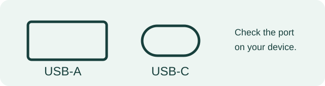

# Make your emergency USB drive

**United States · English (en-US) · reviewed November 9, 2026**

You need a USB drive and a Windows computer or Android phone. A USB drive is a small storage device that plugs into a port. Look at your device's port **before buying**:

Many computers have **USB-A**. Many newer Android phones have **USB-C**. A drive with both plugs can be convenient. A fitting plug does not guarantee that your phone can read it. Test your own setup.

## 1. Download and unpack

On the [project page](https://github.com/MaxWehrle/emergency-usb-stick), select **Download U.S. package**. Wait for `US-2026.11.09-r2.zip` in **Downloads**.

A **ZIP** is a compressed bundle. **Extract** means taking its files out into a normal folder. Do this first; copying only the ZIP to the drive is not enough.

## 2A. Windows computer: copy to USB

1. Open **File Explorer** (the folder icon), then **Downloads**.
2. Right-click `US-...zip`, choose **Extract All**, then **Extract**.
3. Open the new folder. Look for `START.html`, `guides`, and `personal`. If you see one more folder, open it too.
4. Plug in your USB drive. In File Explorer, open **This PC**, then the USB drive.
5. Return to the extracted folder. Press **Ctrl+A** to select everything inside, then **Ctrl+C** to copy it.
6. Return to the USB drive. Press **Ctrl+V**. Wait for copying to finish. `START.html` must be visible **directly on the drive**.

If the drive has files already or Windows asks to replace files, stop and check what is there. **Formatting erases the drive** and is not needed here.

## 2B. Android phone only

1. Open **Files**, **My Files**, or your file manager. In **Downloads**, tap the ZIP and choose **Extract** or **Unzip**. Names vary by phone.
2. Connect a USB-C drive or suitable adapter. In the file manager, open **USB storage** or **External storage**.
3. Return to the extracted folder. Select **everything inside**, tap **Copy**, choose USB storage, and wait.
4. Reopen USB storage. `START.html` should be at the top level. Tap it and select a browser if asked.

Your phone has **not been tested** by this project. If local HTML will not open, use the regular files in `guides/` with a text app. If copying fails, use another tested device or a computer.

## 3. Add your own files

Open `personal/` on the drive. Put your photos in `Photos/`, lawful offline maps in `Maps/`, non-sensitive documents in `Documents/`, and your local plan in `Local-Info/`. Make a **copy** of `templates/LOCAL-INFO-TEMPLATE.txt` named `personal/Local-Info/local-info.txt` on your USB drive and fill it there. Do not post the filled copy on GitHub.

You may add contacts, a medication list, document copies, family photos, maps, chargers, a compatible adapter and flashlight. Keep sensitive information only in a **tested encrypted vault**; read `private/README.txt` first. No personal files or passwords come with the package.

Your files stay accessible in their folders. Optional: `python tools/build.py` adds their names to `START.html`. Python is **not** needed for ordinary use.

## 4. Test and make a second copy

1. Turn off Wi-Fi and mobile data, or use airplane mode.
2. Open `START.html` **from the USB drive**. Search for **water**, then clear the search.
3. Open `guides/water-sanitation.md` as a regular file; a text editor can read `.md`.
4. Add a harmless test file to `personal/Photos/`. Open it from the drive. Copy it **back to your device** and open that copy. This tests recovery.
5. Safely **Eject** the drive before unplugging, if your device offers it.

Make a **second complete copy** on another drive and keep it in a separate place. Check both after changes and regularly, for example every three months. Repeat the copy-back test. Replace a drive you cannot read.

## 5. Capacity and buying

Check the size of your own files and add about **one third** spare room. Example: 20 GB of files + about 7 GB spare = at least 27 GB needed. Usable capacity may be below the number on the package.

| Your files | With spare room | Drive size to consider |
|---|---:|---:|
| Few photos and documents: 5 GB | about 7 GB | 16–32 GB |
| Many photos and some maps: 35 GB | about 47 GB | 64 GB |
| Large photo or video library: 140 GB | about 187 GB | 256 GB |

Check capacity, plug shape, device support, seller, return policy and total price. No drive is failure-proof. An adapter may be needed; test the entire combination.

On **November 9, 2026**, U.S. Best Buy pages showed a [SanDisk Ultra Dual Drive Go 128 GB](https://www.bestbuy.com/product/sandisk-ultra-dual-drive-go-128gb-usb-type-a-usb-type-c-flash-drive-black/6422263) for **$31.99** and a [256 GB model](https://www.bestbuy.com/product/sandisk-ultra-dual-drive-go-256gb-usb-type-a-usb-type-c-flash-drive-black/6421486) for **$48.99**. [Sandisk lists USB-A and USB-C](https://www.sandisk.com/products/usb-flash-drives/sandisk-ultra-dual-drive-go-usb-3-1-type-c?sku=SDDDC3-128G-G46). Prices, stock, shipping and taxes change; check the current cart. These are examples, not an endorsement or device compatibility test. No affiliate links.

## Ready-to-use checklist

- [ ] `START.html` works offline, or I can read `guides/`.
- [ ] I can find the water guide and my local alert source.
- [ ] I added useful contacts, maps, photos and documents.
- [ ] Sensitive files are only in a tested encrypted vault.
- [ ] I copied a file back and opened it.
- [ ] A second complete copy is stored elsewhere.

**Digital copies do not replace original documents.** Check with the issuing agency when an original or certified copy is needed. Current local alerts and orders take priority.
