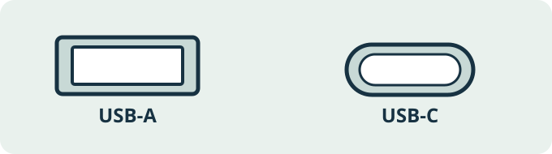

# Der Notfall-Stick: Schritt für Schritt

**Deutschland · einfache Anleitung · Stand 09.11.2026**

Sie brauchen einen USB-Stick und einen Windows-PC **oder** ein Android-Handy. Prüfen Sie vor dem Kauf, welcher Anschluss zu Ihren Geräten passt:

**USB-A** ist an vielen PCs. **USB-C** ist an vielen neueren Android-Handys. Manche Sticks haben beide Stecker. Wenn die Form nicht passt, kann ein passender Adapter helfen. Kaufen Sie erst, wenn Sie die Buchse an Ihren eigenen Geräten angesehen haben.

## 1. Das Paket herunterladen

Öffnen Sie die [Projekt-Startseite](https://github.com/MaxWehrle/emergency-usb-stick) und wählen Sie **„Deutsches Paket herunterladen“**. Die Datei heißt `DE-2026.11.09-r5.zip` (bei einer neueren Ausgabe kann die Zahl anders sein).

Ein **ZIP** ist ein gepacktes Archiv. **Entpacken** legt seinen Inhalt als normale Dateien in einem Ordner ab. Kopieren Sie anschließend den Inhalt dieses Ordners auf den Stick.

## 2A. Mit einem Windows-PC entpacken und kopieren

1. Öffnen Sie den **Datei-Explorer**.
2. Öffnen Sie links **Downloads**. Suchen Sie die Datei, die mit `DE-` beginnt und mit `.zip` endet.
3. Klicken Sie mit der **rechten Maustaste** auf die ZIP-Datei. Wählen Sie **Alle extrahieren** oder **Alles extrahieren**. Klicken Sie dann auf **Extrahieren**. Windows öffnet einen neuen, normalen Ordner.
4. Öffnen Sie den entpackten Ordner. Dort sollten `START.html`, `Anleitungen` und `Eigene-Dateien` liegen. Falls Sie zunächst nur einen weiteren Ordner sehen, öffnen Sie ihn.
5. Stecken Sie den USB-Stick in den PC. Öffnen Sie im Datei-Explorer **Dieser PC** und dann den USB-Stick.
6. Wechseln Sie zurück zum entpackten Ordner. Markieren Sie mit **Strg + A** alles darin und kopieren Sie es mit **Strg + C**.
7. Wechseln Sie zum USB-Stick und fügen Sie alles mit **Strg + V** ein. Warten Sie, bis das Kopieren abgeschlossen ist. **`START.html` muss direkt auf dem Stick liegen.**

Wenn auf dem Stick schon eigene Dateien sind oder Windows fragt, ob Dateien ersetzt werden sollen: Stoppen Sie und prüfen Sie zuerst, was dort liegt. **Formatieren** löscht den Inhalt des Sticks; für diese Anleitung ist das nicht nötig.

## 2B. Nur mit einem Android-Handy

1. Öffnen Sie die App **Dateien**, **Eigene Dateien** oder **Dateimanager**. Suchen Sie unter **Downloads** die heruntergeladene ZIP-Datei.
2. Tippen Sie auf die ZIP-Datei und wählen Sie **Extrahieren**, **Entpacken** oder **In Ordner entpacken**. Die Wörter können je nach Handy anders heißen. Danach sollten `START.html` und die Ordner sichtbar sein.
3. Stecken Sie einen passenden USB-C-Stick oder Adapter an. Öffnen Sie in der Dateien-App den **USB-Speicher**. Er kann auch „Externes Laufwerk“ heißen.
4. Wählen Sie **alle Dateien und Ordner innerhalb** des entpackten Ordners aus. Tippen Sie auf **Kopieren** und wählen Sie den USB-Speicher als Ziel. Warten Sie bis zum Ende.
5. Öffnen Sie den USB-Speicher erneut. `START.html` muss dort direkt liegen. Tippen Sie darauf und wählen Sie einen Browser, falls das Handy fragt.

Einige Handys oder Datei-Apps können USB-Speicher oder lokale HTML-Dateien nicht öffnen. Das wurde **nicht auf Ihrem Gerät getestet**. Wenn `START.html` nicht öffnet, öffnen Sie im USB-Speicher den Ordner `Anleitungen` und lesen Sie die Textdateien. Testen Sie bei Gelegenheit einen anderen Browser oder benutzen Sie einen Windows-PC zum Kopieren.

## 3. Eigene Dateien ergänzen

Öffnen Sie den Ordner `Eigene-Dateien` auf dem Stick:

- In `Fotos` kommen **Ihre** Fotos.
- In `Karten` kommen Offline-Karten, die Sie rechtmäßig gespeichert haben.
- In `Dokumente` kommen eigene **nicht geheime** Dokumente.

Kopieren Sie nur Dateien, die Sie selbst verwenden dürfen. Für Ausweise, Gesundheitsdaten, Passwörter und andere sehr persönliche Unterlagen lesen Sie zuerst `Vertrauliche-Dateien/HINWEIS.txt`. Dort steht, wie Sie einen verschlüsselten Tresor einrichten und **auf Ihren eigenen Geräten testen**. In diesem Paket liegt noch kein Tresor und kein Passwort.

Wenn Sie später Dateien ergänzen, finden Sie sie immer direkt in diesen Ordnern. Optional kann jemand mit Python `python Infrastruktur/Werkzeuge/KATALOG-AKTUALISIEREN.py` ausführen, damit neue Dateinamen auch auf `START.html` verlinkt werden. Für die normale Benutzung brauchen Sie Python nicht.

## 4. Den Stick ausprobieren

1. Schalten Sie WLAN und mobile Daten für den Test aus oder wählen Sie den Flugmodus.
2. Öffnen Sie `START.html` vom Stick. Sehen Sie die Notfall-Themen? Suchen Sie nach **Wasser**. Verschwindet der Text wieder, wenn Sie das Suchwort löschen?
3. Öffnen Sie `Anleitungen/wasser-hygiene.txt` als normale Datei. Wenn Ihr Gerät `.md` nicht anbietet, wählen Sie eine Text-App oder einen Editor.
4. Öffnen Sie eine eigene Testdatei. Kopieren Sie diese Datei **vom Stick zurück auf Ihr Gerät** und öffnen Sie die Kopie. So prüfen Sie, ob Sie Dateien wiederherstellen können.
5. Werfen Sie den Stick über die Funktion **Auswerfen** oder **Sicher entfernen** aus, bevor Sie ihn abziehen.

Machen Sie eine **zweite vollständige Kopie** auf einen zweiten Stick. Bewahren Sie die beiden Sticks an verschiedenen Orten auf. Prüfen Sie beide nach Änderungen und dann regelmäßig, zum Beispiel alle drei Monate. Wenn etwas nicht lesbar ist, ersetzen Sie den fehlerhaften Stick.

## 5. Wie groß soll der Stick sein?

Schauen Sie auf Ihrem Gerät nach, wie viel Speicher Ihre eigenen Dateien belegen. Rechnen Sie etwa **ein Drittel zusätzlich** als Platz für spätere Dateien. Beispiel: 20 GB eigene Dateien + ungefähr 6 GB Platz = mindestens 26 GB nötig. Die angezeigte nutzbare Kapazität kann kleiner sein als die Zahl auf der Verpackung.

| Ihre Dateien | Beispiel | Stick-Größe als Orientierung |
|---|---:|---:|
| Wenige Fotos, Dokumente | 5 GB + Reserve = 7 GB | 16 bis 32 GB |
| Viele Fotos, einige Karten | 35 GB + Reserve = 46 GB | 64 GB |
| Sehr viele Fotos oder Videos | 140 GB + Reserve = 182 GB | 256 GB |

## 6. Kaufbeispiele für Deutschland

Prüfen Sie **Anschluss, Platz, Gesamtpreis mit Versand und Rückgabemöglichkeit**. Kein Stick ist ausfallsicher. Ein USB-C-Stecker allein garantiert nicht, dass Ihr Handy den Stick lesen kann. Testen Sie ihn nach dem Kauf.

Am **09.11.2026** zeigten deutsche Shopseiten diese Beispiele, ohne Affiliate-Links: [Sandisk Ultra Dual Drive Go 128 GB bei MediaMarkt](https://www.mediamarkt.de/de/product/_sandisk-ultra%C2%AE-dual-drive-go-2609988.html) (24,99 € angezeigt) und [Sandisk Ultra Dual Drive Go 256 GB bei MediaMarkt](https://www.mediamarkt.de/de/product/_sandisk-ultrar-dual-drive-go-usb-type-ctm-usb-stick-256-gb-400-mbs-dunkelgrau-2982110.html) (39,99 € angezeigt). Beide Varianten haben laut [Hersteller](https://www.sandisk.com/products/usb-flash-drives/sandisk-ultra-dual-drive-go-usb-3-1-type-c?sku=SDDDC3-128G-G46) USB-A und USB-C. **Preise und Lieferbarkeit ändern sich.** Prüfen Sie den Warenkorb vor dem Kauf. Die Kompatibilität mit Ihrem konkreten Gerät wurde nicht getestet.

## Kurze Merkliste

- [ ] `START.html` öffnet sich ohne Internet.
- [ ] Eine Lagekarte und eine Textdatei sind lesbar.
- [ ] Eigene Kontakte, Dokumente, Fotos und Karten sind ergänzt.
- [ ] Geheime Dateien sind nur im getesteten verschlüsselten Tresor.
- [ ] Eine Datei wurde erfolgreich zurückkopiert.
- [ ] Es gibt eine zweite Kopie an einem anderen Ort.

**Digitale Kopien ersetzen Originaldokumente nicht.** Fragen Sie bei der ausstellenden Stelle, ob ein Original oder eine beglaubigte Kopie nötig ist. Aktuelle behördliche Warnungen und örtliche Anweisungen haben immer Vorrang.
