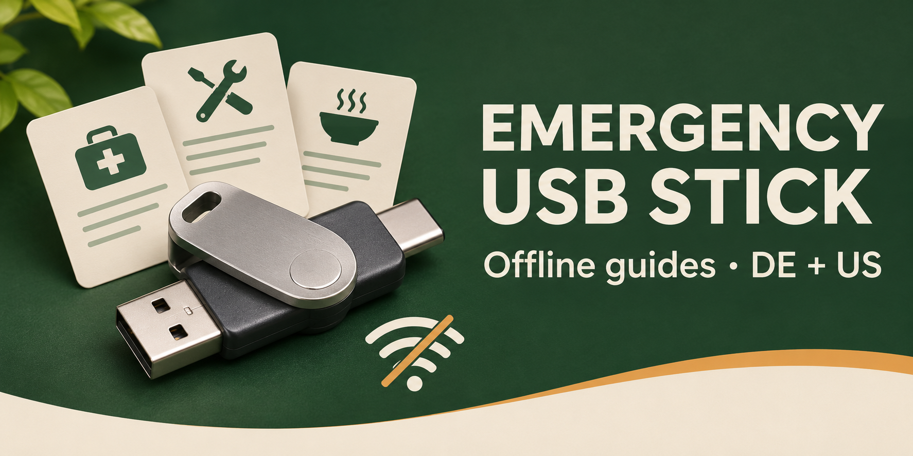

# Emergency USB Stick · Notfall-Stick

Ein USB-Stick mit kurzen Hinweisen für schwierige Situationen und Platz für eigene Dateien. **Nach dem Herunterladen funktioniert das Paket ohne Internet und ohne Installation.** Die Länderfassungen enthalten eigene regionale Hinweise; Sprache und Land werden getrennt angegeben.

A USB drive with short emergency guides and room for your own files. **After download, the package works offline without installing anything.** Each country edition has its own reviewed regional guidance.

## Paket auswählen / Choose a package

| Land / Country | Sprache / Language | Download | Anleitung als PDF | Prüfstand |
|---|---|---|---|---|
| Deutschland | de-DE | [Deutsches Paket (ZIP)](https://raw.githubusercontent.com/MaxWehrle/emergency-usb-stick/main/releases/DE-2026.11.09-r5.zip) | [00-LIESMICH-DE.pdf](https://github.com/MaxWehrle/emergency-usb-stick/blob/country/DE/00-LIESMICH-DE.pdf) | 09.11.2026 · Revision 5 |
| United States | en-US | [U.S. package (ZIP)](https://raw.githubusercontent.com/MaxWehrle/emergency-usb-stick/main/releases/US-2026.11.09-r2.zip) | [00-READ-ME-US.pdf](https://github.com/MaxWehrle/emergency-usb-stick/blob/country/US/00-READ-ME-US.pdf) | Nov 9, 2026 · revision 2 |

### In wenigen Schritten / In a few steps

1. Laden Sie das Paket für Ihr Land herunter und entpacken Sie die ZIP-Datei. / Download your country's package and extract the ZIP.
2. Kopieren Sie den **Inhalt** des entpackten Ordners auf einen USB-Stick. `START.html` und die PDF-Anleitung sollen direkt auf dem Stick liegen. / Copy the **contents** of the extracted folder to a USB drive. `START.html` and the PDF guide should be at the top level.
3. Öffnen Sie `START.html`. Die Hinweise stehen auch als normale Textdateien in `Anleitungen` (DE) oder `Guides` (US). Auf Android können Sie den Stick mit einem passenden Anschluss oder Adapter in der Dateien-App öffnen; ob lokale HTML-Dateien starten, hängt vom Gerät und der App ab. / Open `START.html`. Guides are also ordinary text files in `Guides`. On Android, a suitable connector or adapter and Files app may be needed; local HTML support varies by device and app.
4. Lesen Sie die PDF-Anleitung auf dem Stick. Eigene Dateien gehören in `Eigene-Dateien` (DE) oder `My-Files` (US). Testen Sie das Öffnen ohne Internet und kopieren Sie eine Testdatei zurück. Bewahren Sie eine zweite Kopie getrennt auf. / Read the PDF guide on the drive. Add your files to `My-Files`, test offline, copy a test file back, and keep a second copy elsewhere.

Die Anleitungen gibt es zusätzlich als `00-LIESMICH-DE.txt` und `00-READ-ME-US.txt`. Digitale Kopien ersetzen keine Originaldokumente. Bei akuter Gefahr gelten aktuelle örtliche Warnungen und Anweisungen. / Digital copies do not replace original documents. Follow current local warnings and instructions in an emergency.

## Was im Paket liegt / What's in the package

| Deutschland | United States | Inhalt / Contents |
|---|---|---|
| `START.html` | `START.html` | Offline-Übersicht mit Suche / offline guide with search |
| `00-LIESMICH-DE.pdf` + `.txt` | `00-READ-ME-US.pdf` + `.txt` | Vollständige Anleitung / complete usage guide |
| `Anleitungen` | `Guides` | Kurze Lagekarten als Textdateien / short situation guides as text files |
| `Eigene-Dateien` | `My-Files` | Leere Ordner für eigene Medien / empty folders for your files |
| `Vertrauliche-Dateien` | `Private-Files` | Hinweise zum Schutz sensibler Daten / instructions for protecting sensitive data |
| `Infrastruktur` | `Infrastructure` | Quellen, Lizenz, Technik und optionale Werkzeuge / sources, license, technical files and optional tools |

[Deutsche Fassung ansehen](https://github.com/MaxWehrle/emergency-usb-stick/tree/country/DE) · [View U.S. edition](https://github.com/MaxWehrle/emergency-usb-stick/tree/country/US) · [Quellen DE](https://github.com/MaxWehrle/emergency-usb-stick/blob/country/DE/Infrastruktur/QUELLEN.md) · [U.S. sources](https://github.com/MaxWehrle/emergency-usb-stick/blob/country/US/Infrastructure/SOURCES.md)

## Branches und Veröffentlichung / Branches and releases

- `main` enthält die gemeinsame technische Basis, die Projektstartseite, Beitragsregeln, Lizenz und veröffentlichte ZIP-Dateien.
- `country/DE` enthält das vollständige Paket für Deutschland (`de-DE`); `country/US` enthält das Paket für die USA (`en-US`). Weitere Länder brauchen übersetzte **und regional geprüfte** Inhalte.
- `maintenance` enthält Wartungsabläufe, Prüfschablonen und [kopierbare Prompts](https://github.com/MaxWehrle/emergency-usb-stick/blob/maintenance/maintenance/PROMPTS.md).

Länderbranches heißen `country/<ISO-3166-1-alpha-2>`, Sprachvarianten nutzen BCP-47-Tags. Releases heißen `<COUNTRY>-YYYY.MM.DD-rN`. Gemeinsame technische Änderungen werden auf `main` geprüft und anschließend gezielt in jeden Länderbranch übernommen. Regionaler Text, Pfade und Quellen werden dabei einzeln überprüft; die Pakete werden erneut gebaut und geprüft.

SHA-256: `DE-2026.11.09-r5.zip` = `fabd47fce690376a9f03e6215deef477aa47b1a31ab4775ae6f00d2cbfa058f6`; `US-2026.11.09-r2.zip` = `4f7b4279ad2b3b49cdb716d43cf9e873c40a3e46ce7ed8819b3596de204d1d73`. Ältere Fassungen bleiben unter [releases](releases/) verfügbar.

Geplante GitHub Actions laufen vom Default-Branch; die dortige Workflow-Datei enthält die nötigen Auslöser. Technische Prüfungen ersetzen keine menschliche Quellenprüfung von medizinischen, sicherheitsrelevanten oder regionalrechtlichen Angaben.

Eigene Texte und Code: [MIT-Lizenz](LICENSE). Verlinkte Inhalte Dritter bleiben bei ihren Rechteinhabern und sind nicht Teil der ZIP-Dateien. Korrekturen bitte über [GitHub Issues](https://github.com/MaxWehrle/emergency-usb-stick/issues) melden, ohne persönliche Daten zu veröffentlichen. Siehe [Beitragsregeln](CONTRIBUTING.md).
